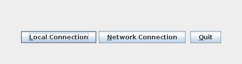
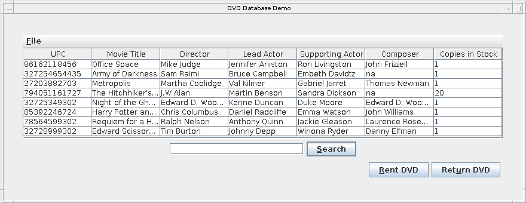

# java-rmi-dvd-database-demo

[](https://github.com/annupuri/java-rmi-dvd-database-demo/actions/workflows/build.yml)

*[English](README.md) | 日本語*

DVD レンタル在庫を管理するシステムの実装デモです。レコード単位の排他制御を備えたファイルベースのデータベース、
Java RMI 経由のリモートアクセス、Swing の管理クライアントを含みます。

## スクリーンショット

クライアントは接続方法の選択から始まり、その後カタログを表示します。





## 構成

- `src/main/java/dvddemo/db` — ファイルベースの DVD データベース本体、レコード単位の排他制御、テキスト管理コンソール
- `src/main/java/dvddemo/remote` — RMI 経由のリモートアクセス
- `src/main/java/dvddemo/gui` — Swing クライアント

## 技術スタック

Java 21、Gradle（Kotlin DSL）。ランタイムは標準ライブラリのみ（RMI、Swing、シリアライズ、`java.util.regex`）で、
外部ライブラリへの依存はありません。テストのみ JUnit 5 を使用します。

## 設計

**レイヤ構成。** Swing クライアントと管理コンソールは、いずれも単一のインターフェース `DBClient`
（検索・貸出・返却・追加・変更・削除）を通してストレージにアクセスします。その背後は次のとおりです。

- `DVDDatabase` — ストレージエンジン。1 レコードにつき 1 つの `*.dvd` ファイル（シリアライズ）をディレクトリに格納し、
  ロックもここが担います。
- `DVDDbAdapter` — `DVDDatabase` をラップする薄い `DBClient`。更新系の各呼び出しをレコードロックで挟みます。

ネットワーク接続では、同じインターフェース上に Java RMI のホップが入ります。サーバ側では
`DVDDatabaseImpl`（エクスポートされた `UnicastRemoteObject`）がアダプタをラップし、クライアント側では
`RemoteDVDClient` がスタブをラップして通常の `DBClient` として再公開します。そのため GUI 側のコードは、
データベースがローカルでもリモートでも同一です。

**並行性。** ロックはデータベース全体に 1 つではなく、レコード単位です。

- `reserveDVD(upc)` / `releaseDVD(upc)` がロック中の UPC をプロセス全体で共有する集合に記録します。
  *同じ* UPC に対する 2 人目の呼び出しは、保持者が解放するまで `wait()` します。異なる UPC 同士は互いにブロックしません。
- `rent` と `returnRental` は read-modify-write 全体を `try/finally` でレコードロックの保持下に置き、
  その内側のファイル I/O のときだけインスタンスモニタを取ります。ロック順序は固定（まずレコードロック、
  次にインスタンスモニタ）なので、両者がデッドロックすることはありません。
- `DVDDatabaseConcurrencyTest` がこれを検証します。1 つの UPC に対して 8 スレッド × 120 回の貸出／返却で、更新の取りこぼしなし。

## ビルド

```
./gradlew build
```

JDK は Gradle の toolchain 機能が Java 21 を自動解決します（`.tool-versions` は Temurin 21 を指定）。

## テスト

```
./gradlew test
```

JUnit 5 による `DVDDatabase` / `DVDDbAdapter` / `DVD` のテスト（CRUD、正規表現検索、レンタル在庫の増減、
および `rent` / `returnRental` のレコード単位ロックが並行更新を失わないことの検証）を含みます。
`./gradlew build` からも実行されます。

## 実行

Swing クライアントを起動します。

```
./gradlew run
```

起動後のダイアログでローカル接続（同一 JVM 内のファイル DB）か、ネットワーク接続（RMI）を選択します。
ネットワーク接続を使う場合は、先に RMI サーバを起動しておきます。

```
./gradlew runServer   # RMI レジストリ(1099)を起動し DVDMediator をバインド
```

接続先ホストは `./gradlew run -Ddvddemo.hostname=<host>` で指定できます（既定は `localhost`）。

### サンプルデータ

クライアントは空のカタログで起動します。サンプル DVD を数件 `./dvd_db` に投入するには:

```
./gradlew seed
```

### 管理コンソール（DOSClient）

Swing クライアントは検索・貸出・返却のみを行います。カタログへの追加・変更・削除は、テキストメニューの
管理コンソールから行います。

```
./gradlew runDosClient --console=plain -q
```

メニューの `8` でもサンプル DVD を投入できます。DB ディレクトリは既定で `./dvd_db`、第 1 引数で変更できます
（`./gradlew runDosClient --args=/path/to/db ...`、または `./gradlew seed --args=/path/to/db`）。

## 概要

ファイルベース DB に対する並行アクセス制御と、ネットワーク越しのリモートアクセス（RMI）を
組み合わせた学習用プロジェクトです。

元のコードは 2005 年頃に書いたもので、このリポジトリではアーキテクチャ（ファイルベースの記録、
レコード単位ロック、RMI、Swing）を保ったまま、現在のツールチェーン（Java 21、Gradle ビルド、
JUnit 5 のテスト）へ載せ替えています。

## 位置づけ

本番向けソフトウェアではありません。RMI サーバ（`./gradlew runServer`）はポート 1099 に到達できる
任意のクライアントからのオブジェクトをデシリアライズし、認証も行いません。信頼できるローカル
ネットワークでのみ実行し、インターネットには公開しないでください。

個人のポートフォリオプロジェクトです。Issue での不具合報告は歓迎しますが、機能追加を継続的に進めては
いません。

## ライセンス

MIT License — [LICENSE](LICENSE) を参照してください。
