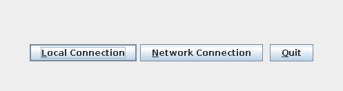
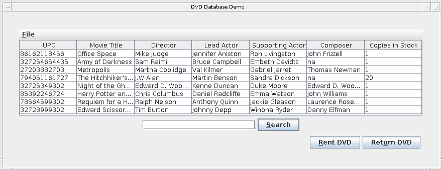

# java-rmi-dvd-database-demo

[](https://github.com/annupuri/java-rmi-dvd-database-demo/actions/workflows/build.yml)

*English | [日本語](README.ja.md)*

A demo implementation of a DVD rental inventory system: a file-backed database with
per-record locking, remote access over Java RMI, and a Swing management client.

## Screenshots

The client opens by asking for a connection type, then shows the catalogue:





## Layout

- `src/main/java/dvddemo/db` — the file-backed DVD database, per-record locking, and a text admin console
- `src/main/java/dvddemo/remote` — remote access over RMI
- `src/main/java/dvddemo/gui` — the Swing client

## Stack

Java 21, Gradle (Kotlin DSL). The runtime depends only on the standard library
(RMI, Swing, serialization, `java.util.regex`) — no third-party libraries. JUnit 5 is used for tests only.

## Design

**Layering.** The Swing client and the admin console both reach storage through a single interface,
`DBClient` (search / rent / return / add / modify / remove). Behind it:

- `DVDDatabase` — the storage engine. One serialized `*.dvd` file per record in a directory, plus the locking.
- `DVDDbAdapter` — a thin `DBClient` over `DVDDatabase` that brackets each mutating call in a record lock.

A network connection puts a Java RMI hop on the same interface: `DVDDatabaseImpl` (an exported
`UnicastRemoteObject`) wraps the adapter on the server; `RemoteDVDClient` wraps the stub on the client
and re-exposes it as a plain `DBClient`, so GUI code is identical whether the database is local or remote.

**Concurrency.** Locking is per record, not one lock for the whole database:

- `reserveDVD(upc)` / `releaseDVD(upc)` track locked UPCs in a process-wide set. A second caller for the
  *same* UPC `wait()`s until the holder releases; different UPCs never block each other.
- `rent` and `returnRental` hold the record lock across the entire read-modify-write in a `try/finally`,
  and take the per-instance monitor only for the file I/O nested inside. The lock order is fixed — record
  lock first, then the instance monitor — so the two cannot deadlock.
- `DVDDatabaseConcurrencyTest` exercises it: 8 threads × 120 rent/return cycles on one UPC, no lost updates.

## Build

```
./gradlew build
```

Gradle's toolchain support resolves a Java 21 JDK automatically (`.tool-versions` pins Temurin 21).

## Test

```
./gradlew test
```

JUnit 5 tests for `DVDDatabase`, `DVDDbAdapter` and `DVD` — CRUD round-trips, regex search, rent/return
stock changes, and verification that the per-record lock around `rent` / `returnRental` does not lose
concurrent updates. `./gradlew build` runs them too.

## Run

Start the Swing client:

```
./gradlew run
```

The startup dialog offers a local connection (a file database in the same JVM) or a network
connection (RMI). For a network connection, start the RMI server first:

```
./gradlew runServer   # starts the RMI registry (1099) and binds DVDMediator
```

The target host is set with `./gradlew run -Ddvddemo.hostname=<host>` (default `localhost`).

### Sample data

The client starts against an empty catalogue. To load a few sample DVDs into `./dvd_db`:

```
./gradlew seed
```

### Admin console (DOSClient)

The Swing client only searches, rents and returns. Adding, modifying and removing catalogue entries
is done from a text-menu admin console:

```
./gradlew runDosClient --console=plain -q
```

Menu option `8` also seeds the sample DVDs. The database directory defaults to `./dvd_db` and can be
changed with the first argument (`./gradlew runDosClient --args=/path/to/db ...`, or
`./gradlew seed --args=/path/to/db`).

## About

A learning project that pairs concurrent access control over a file-backed database with remote
access (RMI) across a network.

The code was first written around 2005; this repository revives it on a current toolchain — Java 21,
a Gradle build, and a JUnit 5 test suite — while keeping the original architecture (file-backed store,
per-record locking, RMI, Swing).

## Scope

Not production software. The RMI server (`./gradlew runServer`) deserializes objects from any client
that can reach port 1099 and does no authentication — run it only on a trusted local network, never
expose it to the internet.

This is a personal portfolio project: bug reports via issues are welcome, but it is not under active
feature development.

## License

MIT License — see [LICENSE](LICENSE).
